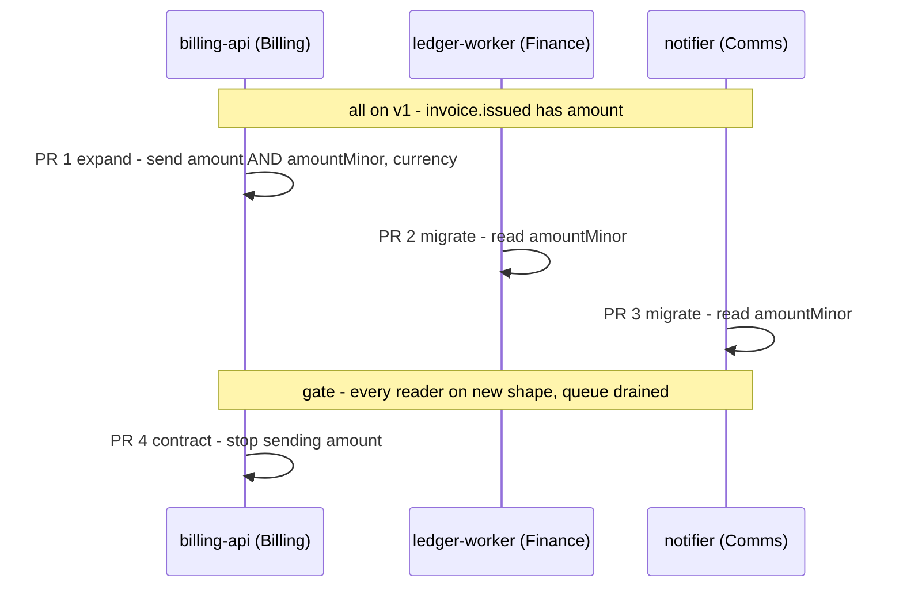

# 10.5 · Changes that cross services and teams

A coding agent can write the three pull requests for a change that spans three services in minutes, and the change can still take three weeks and break production on the way. This lesson is about everything around those pull requests: the window in which old and new versions run together, the order of the phases, who verifies the seam between teams, and how to set up agents so that each team's rules still apply.

## Why it matters

Once coding is fast, the slow and risky part of a change is the part between repositories. One ticket touches a producer owned by one team and readers owned by two others. Each team has its own backlog, reviewers, pipeline and deploy schedule. Each repository's CI checks that repository against its own fixtures, so all three can be green while the system is broken.

This is the first problem an engineering leader brings to an AI-native trainer after the coding agents are in place: "we ship code faster, but changes across teams are no faster, and they break more often." The topologies and handoffs of [10.1](lesson-01.md) and [10.2](lesson-02.md) were about agents working on one repository. Here the "agents" include whole teams, and the shared state is a message format in production.

## How it works

### Merging together is not deploying together

Three pull requests merged in the same minute still deploy through three pipelines, at three speeds. During a rolling deploy the old and new versions of a service run side by side, and messages written by the old version can still be waiting in a queue after it is gone. So between the first deploy and the last there is a **mixed-version window**, and every combination of versions that can be live in it must work.

The rule that follows: **every step of the rollout must be safe while the previous version is still live.** A plan that is only correct once everything is deployed is not a plan.

### Expand, migrate, contract

The standard way to change a shared contract without a broken window is a parallel change in three phases:

1. **Expand.** The producer sends both shapes: the old `amount` and the new `amountMinor` plus `currency`. Nothing reads the new fields yet, so nothing can break.
2. **Migrate.** Each reader moves to the new fields, in its own pull request, on its own team's schedule. The old fields are still there, so a reader's old and new versions both work.
3. **Contract.** Only when every reader is on the new shape in production, and old messages have drained, the producer stops sending the old field.



The cost is one extra pull request and a period of carrying both fields. The two tempting shortcuts both break the window: **producer first** (readers lose `amount`) and **readers first** (they ask for `amountMinor` before anyone sends it).

### Who verifies what

"Who verifies the agent's work?" has three answers in a cross-team change, and each covers something the others cannot:

| Verifier | Checks | Cannot check |
|---|---|---|
| Each repository's tests and owners ([CODEOWNERS](https://docs.github.com/en/repositories/managing-your-repositorys-settings-and-features/customizing-your-repository/about-code-owners) requests their review automatically) | the code in that repository | what other services expect from it |
| A **contract check** across the seam | that every live reader gets every field it needs, at every step | whether the code behind each contract is correct |
| One **change owner** (a person) | the phases, the gate before contraction, the rollback of each phase | line-by-line code in other teams' repositories |

The contract check is the piece most teams lack. In consumer-driven contract testing (Pact is the common tool) each reader records what it expects, and the producer's pipeline verifies against those expectations, so a producer change that would break a reader fails in the producer's CI instead of in production. In the lab, `ContractCheck` does a small version of this for a whole rollout plan.

### Lead time is the critical path

From [10.3](lesson-03.md): the time of a pipeline is its longest path, not the sum of its steps. For a parallel change with $k$ readers,

$$T \approx t_\text{expand} + \max_i\, t_{\text{migrate},i} + t_\text{gate} + t_\text{contract}$$

Example: Billing ships the expand in 1 day, Finance migrates in 3 days, Comms in 9 days because of its backlog, the gate waits 1 day for the queue to drain, and the contract takes 1 day: $1 + \max(3, 9) + 1 + 1 = 12$ days. If agents halve every team's coding time but Comms's 9 days are mostly waiting for a slot in its sprint, the change still takes about 12 days. That is why "agents write the code faster" does not by itself make the change faster: the gain comes from shortening the slowest reader's queue, not from faster typing.

### Setting up the agents

- **One coordinating session** with read access to all the repositories finds every reader and writes the [change manifest](../../templates/cross-service-change.md): the contract change, the phases, the owners, the gate, the rollback per phase. In Claude Code, `--add-dir` gives one session access to other directories. Note that it grants file access only: the `.claude/` configuration of the added directories is not loaded, so the other teams' rules do not apply in that session. That is acceptable for planning, not for editing.
- **One session per repository** does that repository's phase, started inside that repository so its own rules, hooks and permissions apply. Its handoff ([10.2](lesson-02.md)) is the manifest plus the contract file, not the coordinating session's conversation.
- **Different teams use different agents.** The manifest and the contracts are plain markdown and JSON, and repository instructions can live in [AGENTS.md](https://agents.md/), which many agents read. Nothing in the process should depend on one vendor's harness.
- **No agent holds one token that writes to every repository**, and no agent merges or deploys another team's service. That is excessive agency ([09.4](../module-09/lesson-04.md)) with a blast radius of three teams.

> [!NOTE]
> The core ideas here will stay true for years: the mixed-version window, expand-migrate-contract, contracts checked across the seam, splitting verification between repository owners and one change owner, and the critical path as the lead time.
>
> The tool details will go out of date. As of November 2026: the `--add-dir` behaviour of Claude Code, the AGENTS.md convention, and GitHub's CODEOWNERS review requests. `ContractCheck` is a teaching tool for this course, not a product.

## Show me

The agent's plan for BILL-412 (`labs/module-10/break/10.5-big-bang/`) merges three pull requests "atomically" on a Friday. All three repositories' CI is green. The rollout check disagrees:

```text
$ dotnet run --project tools/ContractCheck -- rollout break/10.5-big-bang/services break/10.5-big-bang/plan.json
change: BILL-412 send invoice amounts as integer minor units plus currency
OK    start
BREAK [billing#212] deploying billing-api v1 -> v2 (both live)
        ledger-worker v1 needs 'invoice.issued.amount' (number); billing-api v2 does not send it
        notifier v1 needs 'invoice.issued.amount' (number); billing-api v2 does not send it
BREAK [billing#212] billing-api at v2
...
OK    [notifier#41] notifier at v2
RESULT: 8 broken reader(s) across the rollout — do not ship this plan
```

The end state is fine. Every state between the first deploy and the last is broken: from the moment billing ships until notifier ships, invoices are posted to the ledger and e-mailed to customers without an amount the readers can use.

The phased plan, on the same services:

```text
$ dotnet run --project tools/ContractCheck -- rollout cross-service/solution/services cross-service/solution/phased.plan.json
OK    [billing#212] deploying billing-api v1 -> v2-expand (both live)
OK    [ledger#87] deploying ledger-worker v1 -> v2 (both live)
OK    [notifier#41] deploying notifier v1 -> v2 (both live)
OK    [billing#219] deploying billing-api v2-expand -> v3-contract (both live)
RESULT: every step is safe to deploy

$ dotnet run --project tools/ContractCheck -- owners cross-service/solution/services cross-service/solution/phased.plan.json
[billing#212] billing-api v1 -> v2-expand: approve Billing; notify/approve readers of [invoice.issued]: ledger-worker (Finance Platform), notifier (Customer Comms)
[ledger#87] ledger-worker v1 -> v2: approve Finance Platform
[notifier#41] notifier v1 -> v2: approve Customer Comms
[billing#219] billing-api v2-expand -> v3-contract: approve Billing; notify/approve readers of [invoice.issued]: ledger-worker (Finance Platform), notifier (Customer Comms)
```

(The "after" lines of each step are left out here; all are `OK`.) The `owners` output is the approval list for the manifest: the producer's phases need the readers' teams to know, because they change a message those teams depend on.

## Try it

> [!WARNING]
> Step 3 runs a coding agent, which sends the lab files to your model provider and costs money (a few sessions; well under the cost of one 10.4 trial). Use only these fictional files. Steps 4-6 run offline.

Budget: about 90 minutes. From `labs/module-10`. The lab is described in [`labs/module-10/cross-service`](../../labs/module-10/cross-service/README.md).

1. **Copy the services.** Copy `cross-service/services` to a working folder, for example `~/m10-xs/services`. Each service has only `v1`.
2. **Write the manifest skeleton.** Copy the [cross-service change template](../../templates/cross-service-change.md) to `~/m10-xs/BILL-412.md` and fill in section 1 yourself: the ticket (amounts as integer minor units plus `currency`) and you as change owner.
3. **Coordinating session.** Start your agent in `~/m10-xs/services/billing-api` with the other two services added (Claude Code: `claude --add-dir ../ledger-worker --add-dir ../notifier`). Ask it, in plan mode first ([05.2](../module-05/lesson-02.md)), to find every reader of `invoice.issued`, fill sections 2-6 of `BILL-412.md`, add the new contract versions under each service's `versions/`, and write `~/m10-xs/plan.json` in the format of `break/10.5-big-bang/plan.json`. Tell it every step must be safe with the old version still live.
4. **Check the rollout.** `dotnet run --project tools/ContractCheck -- rollout ~/m10-xs/services ~/m10-xs/plan.json`. If any step breaks, give the agent the output and let it fix the plan, then check again. Count the rounds.
5. **Approvals and lead time.** Run `owners` on the same plan and copy the result into section 2. In section 5 assume Billing 1 day, Finance 3 days, Comms 9 days, gate 1 day, and compute the critical path.
6. **Try the shortcut.** Write `consumers-first.plan.json` (readers to v2, then the producer straight to its final shape) and run `rollout` on it. Keep the output for the manifest's "why not" note.

<details>
<summary>Hint: the agent keeps proposing one pull request per repository</summary>

Three repositories, three pull requests looks natural, and it is the big-bang plan. Ask how many deploys the producer needs. The answer is two (expand, then contract), so a three-team change is four pull requests.
</details>

## Break it

Read [`break/10.5-big-bang/change-manifest.md`](../../labs/module-10/break/10.5-big-bang/change-manifest.md): the agent's plan, three green pipelines, "merge all three on Friday so the change is atomic", rollback "revert the three pull requests", verification "green CI in each repository". Before you run anything, write down three things the manifest gets wrong. Then run:

```bash
dotnet run --project tools/ContractCheck -- rollout break/10.5-big-bang/services break/10.5-big-bang/plan.json
```

## Fix it

**Diagnose.**

1. *Atomic merge, non-atomic deploy.* The three merges land together; the deploys do not, and each rolling deploy runs old and new side by side. `rollout` shows 8 broken readers across five intermediate states.
2. *Each CI checks itself.* Every repository's tests use its own fixtures, which the same agent updated in the same session. No check compares what billing sends with what ledger and notifier read. Green everywhere, broken at the seam.
3. *Rollback is not a phase.* Reverting billing after notifier has shipped breaks notifier the other way. Each phase needs its own rollback, and only phases that are safe with both versions live can be rolled back alone.
4. *One reviewer per repository, nobody for the change.* No person owns the order, the gate or the drain of queued messages.

**Modify.** Rewrite the plan as expand → migrate ledger → migrate notifier → contract: add `billing-api/versions/v2-expand` (sends both shapes) and `v3-contract` (new shape only), keep the readers' `v2`, and put the gate before the contract phase in the manifest: both readers on v2 in production and the `invoice.issued` queue empty of v1-shaped messages. Run the contract check in billing's pipeline on every pull request, not only at the end.

**Rerun.**

```bash
dotnet run --project tools/ContractCheck -- rollout cross-service/solution/services cross-service/solution/phased.plan.json
```

Every step reports `OK`, both while deploying and after.

<details>
<summary>Solution notes</summary>

The worked answer is `cross-service/solution/phased.plan.json`. `consumers-first.plan.json` shows the other shortcut failing: readers on v2 ask for `amountMinor` while billing v1 still runs (16 broken readers). The fix did not make the agent smarter; it gave the plan a property that can be checked at every step, and a person who owns the gate.
</details>

## How do I know it works?

- [ ] `ContractCheck rollout` on your plan prints `RESULT: every step is safe to deploy`, including the "both live" line of every step.
- [ ] Your manifest has one pull request per phase, a rollback per phase, a written gate before the contract phase, and one named change owner.
- [ ] Section 2 lists every reader the agent found, and says how you would catch a reader it missed.
- [ ] Your lead-time estimate uses the critical path (12 days with the given numbers), not the sum of the steps.

## Use / don't use

**Use** expand-migrate-contract for any change to something another service or team reads: messages, API responses, database columns read by other services, file formats, configuration keys. **Use** a coordinating session to find readers and draft the manifest, and per-repository sessions to make the changes. **Use** a contract check in the producer's pipeline once there is more than one reader.

**Don't** treat a monorepo or a multi-repository merge tool as making the change atomic: rolling deploys and queued messages still create a mixed-version window. **Don't** expand and contract a field that only one service reads and writes; that is an ordinary change. **Don't** let the coordinating session edit other teams' repositories with its `--add-dir` access, where their rules do not apply.

**Limitations.** `ContractCheck` checks field names and types, not meaning: a field that changes from major to minor units under the same name passes it, which is why the new field gets a new name. It also does not know about readers that never published a contract; finding those is the coordinating session's search plus the owners' review.

## Reflect

1. What was the last change at your company that crossed two teams, and which phase of expand-migrate-contract did it skip?
2. In your organisation, who would be the change owner for BILL-412, and do they have the authority to hold the contract phase until the gate is met?
3. Which reader's queue would be the critical path, and what could shorten it besides faster coding?

## Sources

- [Martin Fowler (Danilo Sato) — Parallel Change](https://martinfowler.com/bliki/ParallelChange.html) — "also known as expand and contract": a backward-incompatible change in three phases, expand, migrate and contract.
- [Software Engineering at Google — Chapter 22, Large-Scale Changes](https://abseil.io/resources/swe-book/html/ch22.html) — large changes are split by project boundaries and ownership into independently submittable pieces; review by owners and by a global approver.
- [Pact Docs — Introduction](https://docs.pact.io/) — consumer-driven contract testing: the contract is generated by the consumer's tests and verified against the provider.
- [GitHub Docs — About code owners](https://docs.github.com/en/repositories/managing-your-repositorys-settings-and-features/customizing-your-repository/about-code-owners) — code owners are requested for review automatically when a pull request modifies code they own.
- [Claude Code docs — CLI reference](https://code.claude.com/docs/en/cli-reference) — `--add-dir` adds working directories the session can read and edit; their `.claude/` configuration is not discovered (checked 2026-11-10).
- [AGENTS.md](https://agents.md/) — an open, agent-neutral format for repository instructions, read by many coding agents (checked 2026-11-10).
